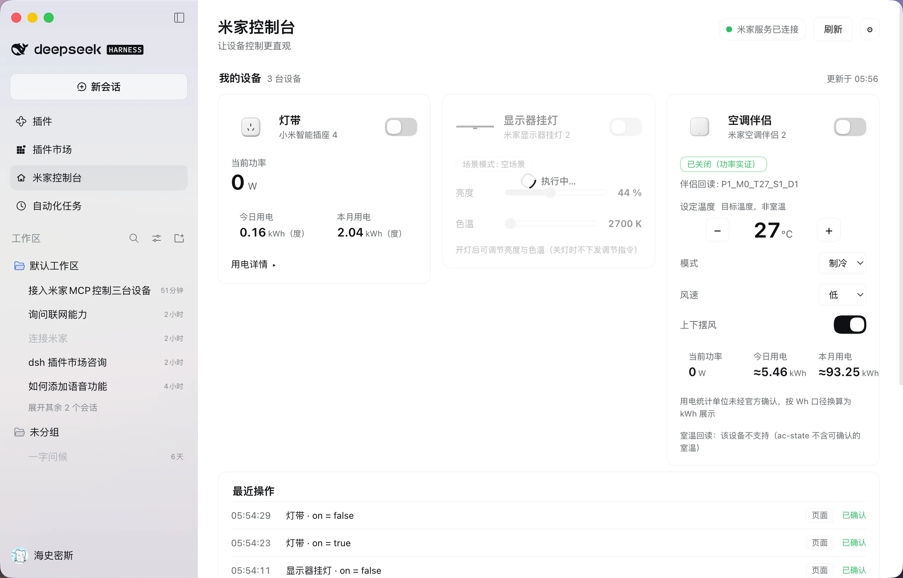

# 米家控制台 for DeepSeek Harness（dsh-mijia-console）

在 [DeepSeek Harness](https://github.com/deepseek-ai/deepseek-harness) 中直接控制米家设备：MCP 接入 + 执行层设备白名单守卫 + 可视化控制台页面。**无需 Home Assistant / Docker / 虚拟机**——经 [Do1e/mijia-api](https://github.com/Do1e/mijia-api) 直连米家云端。



## 功能

- **文字/语音控制**：米家 MCP server（stdio）接入 Harness，14 个工具注册为 `mcp__mijia__*`
- **执行层白名单守卫**：仅三台白名单设备可读写（did 精确匹配）；禁用场景/音箱/未识别工具；禁止 toggle，强制显式开/关
- **可视化控制台页面**：侧边栏入口 → 主面板三张设备卡片
  - 灯带（小米智能插座 4）：开关、实时功率、今日/本月用电、最近 7 天明细（无调光控件——它是插座）
  - 显示器挂灯 2：开关、亮度（1–100%）与色温（2700–6500K）滑块，拖动预览、松手提交
  - 空调伴侣 2：开关、目标温度（16–30℃）、模式/风速/摆风、实时功率、日/月用电；如实区分"指令已发送"与"功率实证确认"
- **真实数据**：全部来自米家云端接口；缺失显示 `--`；连接徽标来自真实请求结果；凭据只在后端（`~/.config/mijia-api/auth.json`），路由经宿主连接层鉴权
- **最近操作**：页面操作（带回读确认）与语音/聊天操作（经 `tools/result` 观察）统一记录
- **轻量按需**：默认手动刷新；可选自动刷新（30s，仅页面可见时）；页面关闭即停止全部请求；MCP 进程随插件启停

## 仓库结构

```
bundles/
  mijia-mcp/       # 米家 MCP 连接（stdio）+ 执行层白名单守卫 + 系统提示词规则
  mijia-console/   # 可视化控制台页面（Host 路由 + Client 面板）
docs/
  HANDOVER.md      # 验收交接文档：安装/启停/能力矩阵/实测记录/未验证项
  images/          # 运行截图
```

## 安装

前置：macOS/Linux，[uv](https://docs.astral.sh/uv/)，DeepSeek Harness 桌面版。

```bash
# 1. 独立 Python 环境 + mijiaAPI（含 mcp 依赖）
uv venv ~/.local/share/mijia-api/venv --python 3.12
uv pip install --python ~/.local/share/mijia-api/venv/bin/python "mijiaAPI[mcp]"

# 2. 扫码登录（凭据存于 ~/.config/mijia-api/auth.json，勿外泄）
~/.local/share/mijia-api/venv/bin/mijiaAPI login
```

3. 在 Harness 插件管理中分别安装 `bundles/mijia-mcp` 与 `bundles/mijia-console` 两个本地目录。

> ⚠️ `bundles/*/cordis.patch.yml` 中的设备 did、米家名称与绝对路径是**作者自己环境的实际值**——安装前请改成你的设备（先在聊天里让助手 `list_devices` 拿到你的 did/名称）与本机路径。

## 启停

- 插件管理禁用/启用 `include:mijia-api` 即停止/拉起 MCP 进程（凭据从磁盘恢复，无需重扫；token 失效时用 `mcp__mijia__login` 会话内重登）
- 禁用 `include:mijia-console` 仅关闭控制台页面，不影响文字/语音控制

## 依赖与许可

- 本仓库代码（两个 bundle）：[MIT](LICENSE)
- 运行时依赖 [mijiaAPI](https://github.com/Do1e/mijia-api)（GPL-3.0，独立 Python 进程经 MCP stdio 调用，本仓库不包含其代码）；请遵守其许可与免责条款，仅供学习交流
- 设备产品图为小米官方产品渲染图，版权归小米；仅作设备识别用途

## 实测状态

灯带与空调伴侣的**开/关闭环**均经真实设备验证（功率实证）；挂灯开/关经接口确认；其余细节与未验证项见 [docs/HANDOVER.md](docs/HANDOVER.md)。用电统计口径：插座为 kWh（日/月交叉验证一致）；空调伴侣原始值按 Wh 解读（官方未确认）。
